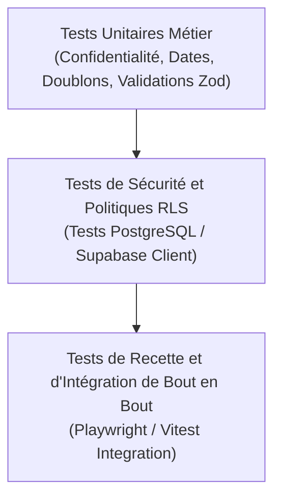

# Plan de Tests et d'Assurance Qualité

Ce document détaille la stratégie et les scénarios de tests automatisés et manuels requis pour valider les critères de recette de la première version (sections 15.3 et 20 du **Cahier des charges fonctionnel et technique v1.0**).

---

## 1. Vue d'ensemble de la Pyramide de Tests



---

## 2. Matrice des Scénarios de Test

### 2.1. Confidentialité et RLS (Section 6 & 14)

| Réf | Scénario | Données en entrée | Résultat attendu | Statut |
| :--- | :--- | :--- | :--- | :--- |
| **SEC-01** | Consultation d'une personne décédée publique | `id = v_p_patriarch` (1842-1912, deceased, public) | Données retournées avec succès pour visiteur anonyme (`anon`). | Prêt |
| **SEC-02** | Tentative de consultation d'une personne vivante | `id = v_p_living` (né en 1985, living) | Requête vide (0 résultat) ou HTTP 404. Aucune fuite d'identité. | Prêt |
| **SEC-03** | Tentative de consultation d'une personne au statut inconnu | `id = v_p_unknown` (life_status = 'unknown') | Requête vide (0 résultat). Le statut inconnu n'est jamais considéré décédé. | Prêt |
| **SEC-04** | Tentative d'accès à une personne archivée | `id = ...` avec `archived_at` non nul | Requête vide (0 résultat) pour non-administrateur. | Prêt |
| **SEC-05** | Consultation d'une relation reliant une personne vivante | Lien père-fils entre `v_p_child_dec` (décédé) et `v_p_living` (vivant) | Relation invisible pour le public. L'entourage de la personne décédée n'affiche pas l'enfant vivant. | Prêt |
| **SEC-06** | Protection des notes privées d'une source publique | Source avec `is_public = true` et `private_notes` renseigné | La colonne `private_notes` n'est jamais transmise au client public. | Prêt |
| **SEC-07** | Inaccessibilité d'une source privée | Source avec `is_public = false` | Source introuvable pour non-administrateur. | Prêt |
| **SEC-08** | Inaccessibilité des brouillons d'articles | Article avec `status = 'draft'` | Accès refusé / 404 pour non-administrateur même en connaissant le slug ou l'UUID. | Prêt |
| **SEC-09** | Tentative d'auto-attribution du rôle `admin` | Requête `UPDATE profiles SET role = 'admin' WHERE id = auth.uid()` | Exception PostgreSQL déclenchée par trigger. Opération rejetée. | Prêt |

---

### 2.2. Intégrité Généalogique et Dates (Section 5)

| Réf | Scénario | Données en entrée | Résultat attendu | Statut |
| :--- | :--- | :--- | :--- | :--- |
| **GEN-01** | Date exacte | `date: '1842-07-14'`, `precision: 'exact'` | Affichage textuel : "14 juillet 1842". | Test unitaire validé |
| **GEN-02** | Année seule (date partielle) | `year: 1842`, `precision: 'year_only'`, pas de jour/mois | Affichage textuel : "1842" (aucun 1er janvier inventé). | Test unitaire validé |
| **GEN-03** | Période approximative | `year: 1840`, `precision: 'approximate'` | Affichage : "vers 1840". | Test unitaire validé |
| **GEN-04** | Interdiction de décès pour une personne vivante | Payload avec `life_status = 'living'` et `death_year = 2020` | Rejet par validation Zod et contrainte CHECK PostgreSQL. | Prêt |
| **GEN-05** | Incohérence chronologique naissance > décès | `birth_year = 1910`, `death_year = 1890` | Rejet par validation Zod et contrainte CHECK PostgreSQL. | Prêt |
| **GEN-06** | Détection de cycle dans la filiation | A est parent de B, B est parent de C, tentative d'insérer C parent de A | Trigger `check_relationship_cycles` lève une exception et bloque l'insertion. | Prêt |
| **GEN-07** | Détection de doublons potentiels | Nouveau Pierre Dupont né vers 1842 | Score de similarité élevé (>80) et signalement des motifs à l'administrateur. | Test unitaire validé |

---

### 2.3. Workflow de Contribution et Modération (Section 7 & 14.5)

| Réf | Scénario | Acteur | Résultat attendu | Statut |
| :--- | :--- | :--- | :--- | :--- |
| **MOD-01** | Soumission d'une proposition par un membre | Utilisateur connecté | Proposition enregistrée en base dans `proposals` avec statut `pending`. Données officielles inchangées. | Prêt |
| **MOD-02** | Tentative d'auto-acceptation d'une proposition | Utilisateur connecté | Rejeté par la politique RLS `proposals_update_admin_only`. | Prêt |
| **MOD-03** | Validation d'une proposition par l'administrateur | Administrateur | Fonction `review_proposal_transaction` exécutée : personne créée, statut = `accepted`, ligne créée dans `audit_logs`. | Prêt |
| **MOD-04** | Refus d'une proposition avec motif | Administrateur | Statut = `rejected`, motif conservé, aucune modification sur les fiches officielles. | Prêt |
| **MOD-05** | Prévention des validations concurrentes | Deux administrateurs validant simultanément | Le verrou `FOR UPDATE` sérialise les requêtes ; la seconde reçoit l'erreur "Proposition déjà traitée". | Prêt |
| **MOD-06** | Annulation en cas d'erreur dans la transaction | Proposition contenant une incohérence relationnelle | Rollback complet : ni la fiche ni le statut de proposition ne sont corrompus. | Prêt |

---

### 2.4. Procédure de Sauvegarde et Restauration (Section 15.1)

1. **Sauvegarde :**
   Exécution d'un dump PostgreSQL complet du schéma et des données :
   ```bash
   pg_dump -h <host> -U postgres -d postgres -F c -b -v -f backup_hapses_$(date +%Y%m%d).dump
   ```
2. **Vérification d'intégrité :**
   Création d'une base de test temporaire et restauration du fichier dump :
   ```bash
   createdb -h <host> -U postgres hapses_restore_test
   pg_restore -h <host> -U postgres -d hapses_restore_test -v backup_hapses_*.dump
   ```
3. **Validation :**
   Exécution de la suite de tests de sécurité et vérification des sommes de contrôle sur les tables `persons`, `relationships` et `audit_logs`.
