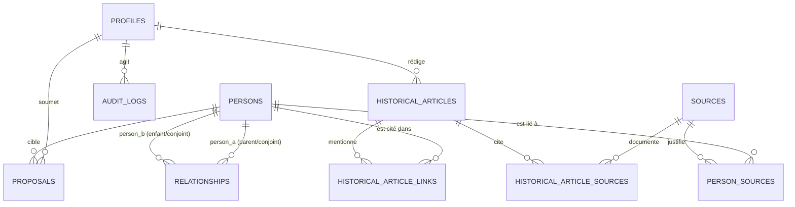

# Architecture du Schéma Relationnel

Ce document décrit en détail le modèle de données de la plateforme généalogique et historique collaborative, conforme aux spécifications du **Cahier des charges fonctionnel et technique v1.0**.

---

## 1. Vue d'ensemble

Le modèle relationnel est conçu sous PostgreSQL (Supabase) pour garantir :
- L'intégrité référentielle stricte et la non-duplication des données.
- La protection absolue des personnes vivantes et des statuts inconnus.
- La séparation entre données officielles validées et propositions d'utilisateurs.
- L'immuabilité du journal d'audit.
- La traçabilité des sources et des modifications.

---

## 2. Types Énumérés (Enums)

| Type ENUM | Valeurs autorisées | Description |
| :--- | :--- | :--- |
| `date_precision` | `exact`, `year_only`, `month_year`, `approximate`, `before`, `after`, `unknown` | Précision historique évitant d'inventer des jours ou mois fictifs |
| `life_status` | `living`, `deceased`, `unknown` | Statut de vie vital pour la confidentialité |
| `visibility_status` | `public`, `private` | Niveau de visibilité explicite |
| `relationship_type` | `parent_child`, `spouse` | Types de liens familiaux MVP |
| `proposal_type` | `add_person`, `update_person`, `add_relationship`, `update_relationship` | Types de contributions possibles |
| `proposal_status` | `pending`, `accepted`, `rejected`, `needs_information` | États du cycle de modération |
| `user_role` | `user`, `admin` | Rôles de la plateforme |

---

## 3. Détail des Tables

### 3.1. `public.profiles`
Lié de manière 1:1 à la table système `auth.users`.

| Colonne | Type | Contraintes | Description |
| :--- | :--- | :--- | :--- |
| `id` | `UUID` | PK, FK auth.users(id) ON DELETE CASCADE | Identifiant unique du compte |
| `display_name` | `TEXT` | NOT NULL, char_length >= 2 | Nom affiché public |
| `role` | `user_role` | NOT NULL, DEFAULT 'user' | Rôle applicatif (protégé contre l'auto-élévation) |
| `created_at` | `TIMESTAMPTZ` | NOT NULL, DEFAULT now() | Date de création du profil |
| `updated_at` | `TIMESTAMPTZ` | NOT NULL, DEFAULT now() | Date de dernière mise à jour |

> **Règle de sécurité :** Un trigger (`protect_profile_role`) interdit à tout utilisateur de modifier lui-même son rôle `role`. Seul un administrateur ou `service_role` peut modifier ce champ.

---

### 3.2. `public.persons`
Table centrale des fiches généalogiques officielles.

| Colonne | Type | Contraintes | Description |
| :--- | :--- | :--- | :--- |
| `id` | `UUID` | PK, DEFAULT gen_random_uuid() | Identifiant interne |
| `first_names` | `TEXT` | NOT NULL | Prénom(s) |
| `last_name` | `TEXT` | NOT NULL | Nom de famille |
| `name_variants` | `TEXT[]` | NOT NULL, DEFAULT '{}' | Variantes orthographiques (ex: Dupond/Dupont) |
| `gender` | `TEXT` | CHECK in ('M','F','other','unknown') | Genre historique |
| `birth_date` | `DATE` | NULLABLE | Date exacte si connue |
| `birth_date_precision` | `date_precision` | NOT NULL, DEFAULT 'unknown' | Précision de la date de naissance |
| `birth_year` | `INTEGER` | CHECK (800 <= year <= 2100) | Année connue indépendamment |
| `birth_place` | `TEXT` | NULLABLE | Lieu de naissance |
| `death_date` | `DATE` | NULLABLE | Date de décès exacte |
| `death_date_precision` | `date_precision` | NOT NULL, DEFAULT 'unknown' | Précision de la date de décès |
| `death_year` | `INTEGER` | CHECK (800 <= year <= 2100) | Année de décès |
| `death_place` | `TEXT` | NULLABLE | Lieu de décès |
| `life_status` | `life_status` | NOT NULL, DEFAULT 'unknown' | Statut de vie |
| `visibility` | `visibility_status` | NOT NULL, DEFAULT 'private' | Statut de visibilité |
| `profession` | `TEXT` | NULLABLE | Métier ou activité |
| `biography` | `TEXT` | NULLABLE | Courte biographie |
| `notes` | `TEXT` | NULLABLE | Notes internes de recherche |
| `created_by` | `UUID` | FK auth.users(id) | Auteur initial |
| `created_at` | `TIMESTAMPTZ` | NOT NULL, DEFAULT now() | Horodatage de création |
| `updated_at` | `TIMESTAMPTZ` | NOT NULL, DEFAULT now() | Horodatage de modification |
| `archived_at` | `TIMESTAMPTZ` | NULLABLE | Horodatage d'archivage |

#### Contraintes de cohérence (CHECK constraints) :
1. `chk_living_no_death` : Si `life_status = 'living'`, `death_date` et `death_year` doivent obligatoirement être `NULL`.
2. `chk_death_implies_deceased` : Si une date ou une année de décès est saisie, `life_status` doit obligatoirement être `deceased`.
3. `chk_birth_death_years` : `birth_year <= death_year`.
4. `chk_birth_death_dates` : `birth_date <= death_date`.

---

### 3.3. `public.relationships`
Table représentant les liens familiaux entre deux personnes distinctes.

| Colonne | Type | Contraintes | Description |
| :--- | :--- | :--- | :--- |
| `id` | `UUID` | PK, DEFAULT gen_random_uuid() | Identifiant de la relation |
| `relationship_type` | `relationship_type` | NOT NULL | Type de lien : `parent_child` ou `spouse` |
| `person_a_id` | `UUID` | NOT NULL, FK persons(id) | Personne A (**Parent** si parent_child, ou Conjoint 1) |
| `person_b_id` | `UUID` | NOT NULL, FK persons(id) | Personne B (**Enfant** si parent_child, ou Conjoint 2) |
| `start_date` | `DATE` | NULLABLE | Date de mariage/union |
| `start_date_precision` | `date_precision` | NOT NULL, DEFAULT 'unknown' | Précision de début |
| `start_year` | `INTEGER` | NULLABLE | Année de début |
| `start_place` | `TEXT` | NULLABLE | Lieu de début |
| `end_date` | `DATE` | NULLABLE | Date de fin (ex: divorce, décès) |
| `end_date_precision` | `date_precision` | NOT NULL, DEFAULT 'unknown' | Précision de fin |
| `end_year` | `INTEGER` | NULLABLE | Année de fin |
| `end_place` | `TEXT` | NULLABLE | Lieu de fin |
| `notes` | `TEXT` | NULLABLE | Notes sur la relation |
| `created_by` | `UUID` | FK auth.users(id) | Auteur |
| `created_at` | `TIMESTAMPTZ` | NOT NULL, DEFAULT now() | Date de création |
| `updated_at` | `TIMESTAMPTZ` | NOT NULL, DEFAULT now() | Date de mise à jour |
| `archived_at` | `TIMESTAMPTZ` | NULLABLE | Date d'archivage |

#### Règles d'intégrité des relations :
- `chk_not_self_relationship` : Interdiction formelle de créer une relation d'une personne avec elle-même (`person_a_id <> person_b_id`).
- Index d'unicité partiel pour parent-enfant : `UNIQUE (person_a_id, person_b_id) WHERE relationship_type = 'parent_child' AND archived_at IS NULL`.
- Index d'unicité symétrique pour conjoints : `UNIQUE (LEAST(person_a_id, person_b_id), GREATEST(person_a_id, person_b_id)) WHERE relationship_type = 'spouse' AND archived_at IS NULL`.
- **Trigger anti-boucle généalogique (`check_relationship_cycles`)** : Requête récursive CTE vérifiant avant toute insertion ou modification qu'un enfant ne peut pas déjà être l'ancêtre de son parent.

---

### 3.4. `public.sources`
Enregistrement des preuves, actes et documents patrimoniaux.

| Colonne | Type | Contraintes | Description |
| :--- | :--- | :--- | :--- |
| `id` | `UUID` | PK, DEFAULT gen_random_uuid() | Identifiant de la source |
| `title` | `TEXT` | NOT NULL | Intitulé de la source |
| `source_type` | `TEXT` | NOT NULL | Type : registre paroissial, état civil, acte notarié... |
| `author_or_organization` | `TEXT` | NULLABLE | Auteur ou organisme conservateur |
| `source_date` | `TEXT` | NULLABLE | Date ou période de la source |
| `archive_reference` | `TEXT` | NULLABLE | Cote d'archive (ex: 5E 123/4) |
| `url` | `TEXT` | NULLABLE | Lien web vers l'archive numérisée |
| `description` | `TEXT` | NULLABLE | Description du document |
| `private_notes` | `TEXT` | NULLABLE | **Notes privées strictement confidentielles** |
| `is_public` | `BOOLEAN` | NOT NULL, **DEFAULT FALSE** | Indicateur de publication |
| `rights_status` | `TEXT` | NULLABLE | Statut des droits (domaine public, copyright...) |
| `created_by` | `UUID` | FK auth.users(id) | Créateur |
| `created_at` | `TIMESTAMPTZ` | NOT NULL, DEFAULT now() | Date de création |
| `updated_at` | `TIMESTAMPTZ` | NOT NULL, DEFAULT now() | Date de modification |

---

### 3.5. `public.person_sources`
Table de liaison plusieurs-à-plusieurs entre personnes et sources.
- Clé primaire : `(person_id, source_id)`.
- Colonne complémentaire : `description TEXT` (ex: "Acte de baptême", "Mention au recensement").

---

### 3.6. `public.proposals`
Stockage isolé des contributions des utilisateurs en attente de modération.

| Colonne | Type | Contraintes | Description |
| :--- | :--- | :--- | :--- |
| `id` | `UUID` | PK, DEFAULT gen_random_uuid() | Identifiant de la proposition |
| `submitted_by` | `UUID` | NOT NULL, FK auth.users(id) | Auteur de la proposition |
| `proposal_type` | `proposal_type` | NOT NULL | Type d'ajout ou de correction |
| `target_person_id` | `UUID` | FK persons(id) ON DELETE SET NULL | Personne visée (si modification) |
| `target_relationship_id` | `UUID` | FK relationships(id) ON DELETE SET NULL | Relation visée (si modification) |
| `payload` | `JSONB` | NOT NULL | Données proposées structurées |
| `sources_info` | `JSONB` | NULLABLE | Références et sources soumises |
| `status` | `proposal_status` | NOT NULL, DEFAULT 'pending' | `pending`, `accepted`, `rejected`, `needs_information` |
| `reviewed_by` | `UUID` | FK auth.users(id) | Administrateur ayant traité |
| `reviewed_at` | `TIMESTAMPTZ` | NULLABLE | Horodatage de modération |
| `review_comment` | `TEXT` | NULLABLE | Motif ou explications de l'administrateur |
| `created_at` | `TIMESTAMPTZ` | NOT NULL, DEFAULT now() | Date de soumission |
| `updated_at` | `TIMESTAMPTZ` | NOT NULL, DEFAULT now() | Date de mise à jour |

---

### 3.7. `public.historical_articles`
Articles d'histoire locale et monographies de familles.

| Colonne | Type | Contraintes | Description |
| :--- | :--- | :--- | :--- |
| `id` | `UUID` | PK, DEFAULT gen_random_uuid() | Identifiant de l'article |
| `article_type` | `TEXT` | CHECK in ('village_history', 'family') | Type d'article |
| `title` | `TEXT` | NOT NULL | Titre de l'article |
| `slug` | `TEXT` | NOT NULL, UNIQUE | Identifiant textuel pour l'URL |
| `summary` | `TEXT` | NULLABLE | Résumé / Chapeau |
| `content` | `TEXT` | NOT NULL | Corps de texte (Markdown sécurisé) |
| `period_start` | `INTEGER` | NULLABLE | Début de période (année) |
| `period_end` | `INTEGER` | NULLABLE | Fin de période (année) |
| `period_description`| `TEXT` | NULLABLE | Ex: "XIXe siècle", "Sous l'Ancien Régime" |
| `family_name` | `TEXT` | NULLABLE | Nom de la famille (si type family) |
| `status` | `TEXT` | CHECK in ('draft', 'published', 'archived') | Statut éditorial |
| `featured_image_url`| `TEXT` | NULLABLE | Image principale |
| `featured_image_credit`| `TEXT` | NULLABLE | Crédit et droits de l'image |
| `author_id` | `UUID` | FK auth.users(id) | Auteur éditorial |
| `published_at` | `TIMESTAMPTZ` | NULLABLE | Date de publication |
| `created_at` | `TIMESTAMPTZ` | NOT NULL, DEFAULT now() | Date de création |
| `updated_at` | `TIMESTAMPTZ` | NOT NULL, DEFAULT now() | Date de modification |

---

### 3.8. Tables de liaison des articles
- `public.historical_article_links` : lie un article à une personne (`article_id`, `person_id`, `context`).
- `public.historical_article_sources` : lie un article à une source (`article_id`, `source_id`, `citation_details`).

---

### 3.9. `public.audit_logs`
Journal immuable des actions sensibles (modérations, modifications de fiches, changements de rôles, archivages).
- `id UUID PRIMARY KEY`
- `actor_id UUID REFERENCES auth.users(id)`
- `action TEXT NOT NULL`
- `entity_type TEXT NOT NULL`
- `entity_id UUID`
- `details JSONB NOT NULL DEFAULT '{}'`
- `created_at TIMESTAMPTZ NOT NULL DEFAULT now()`

> **Immuabilité :** Les politiques RLS interdisent tout `UPDATE` ou `DELETE` sur la table `audit_logs`.
